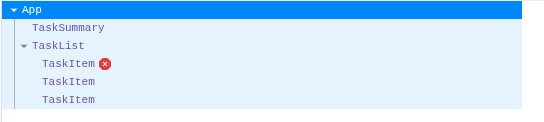
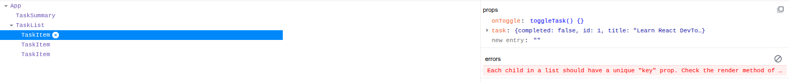
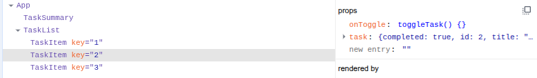
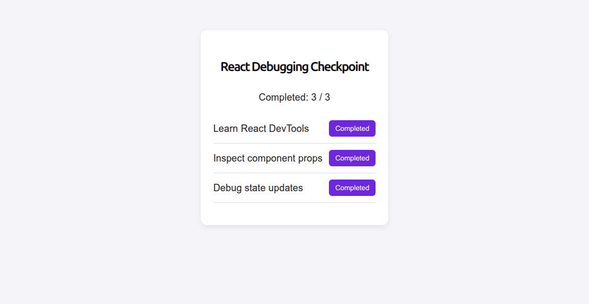

# GMC React Developer Tools Debugging Checkpoint

## Overview

A sample React application used to practice debugging components,
props, and state using React Developer Tools.

## Issues Identified and Fixed

### 1. Missing React Keys

Added a unique key to each TaskItem rendered by TaskList.

### 2. Incorrect State Updates

Replaced direct mutation of the tasks array with an immutable
state update using the functional form of setState.

### 3. Component and Props Inspection

Used React Developer Tools to inspect the component tree and
trace the onToggle function from App to TaskItem.

## Verification

- Verified that all three tasks render correctly.
- Confirmed that task buttons update when clicked.
- Confirmed that the completed count updates correctly.
- Checked that the missing-key warning was resolved.

## Test Screenshots

### Component Tree

### State Before and After

### Working Application

